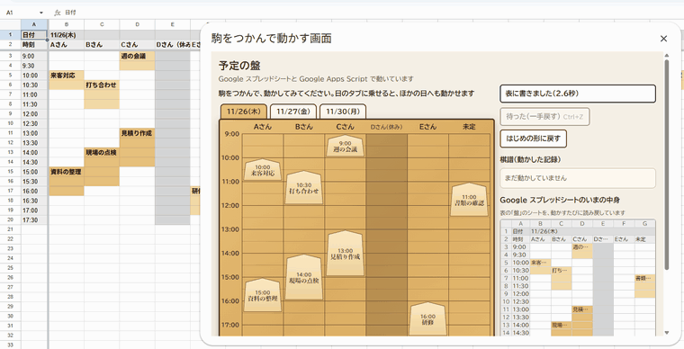

# 予定の盤

Google スプレッドシートの予定を、将棋の駒のようにつかんで動かせる画面です。Google Apps Script（GAS）で作りました。

- 駒（予定）をつかんで離すと、画面はすぐ動き、裏で GAS がスプレッドシートに書きます（1手 およそ2.5〜3.5秒。画面はそれを待ちません）
- 盤は3日（今日を含む平日3日）。日のタブで日を替えられます。駒をつかんだまま日のタブに乗せて少し待つと、その日の盤に替わり、そのまま好きな所に置けます。タブの上で離すと、同じ担当・同じ時刻でその日へ動きます
- ほかの予定と重なる所・盤の外には置けません。どの日のどの予定と重なるかを言って、元の所へ戻ります。休みの担当は日ごとに違います
- 待った（一手戻す）・はじめの形に戻す・棋譜（動かした記録）
- 2人が同時に同じ駒を動かしても、表は食い違いません。後から届いた方に「ほかの人が先に動かしました」と言って、表の形に合わせます
- マウスでも指でも動かせます。スプレッドシートのメニューから窓で開くことも、ウェブの画面として開くこともできます

この盤の人と予定は、すべて作り物です。



## 触ってみる

https://script.google.com/macros/s/AKfycbzf4gh0BJ3rWZpaxErrB11fhszA4jX-DABXvpLBJQb9XNgtD9TyF0wUzrt3ig6dFUCPTA/exec

ログインなしで開けます。盤はみんなで1つなので、ほかの人が動かした手も出ます。10分だれも動かさないと、はじめの形に戻ります。

## しくみ

```
ブラウザ（画面）                         Google Apps Script                      Google スプレッドシート
 駒を離す
  ├ 芯で「置けるか」を決め、すぐ動かす
  └ google.script.run で頼む ───────▶ 鍵を取る → 一覧を読む
    （押した順に1つずつ）              → 同じ芯で決め直す ─────────────▶ 「一覧」「盤」「棋譜」に書く
 「表に書きました（2.8秒）」◀──────── 「盤」を読み戻して返す ◀────────────
```

- 判断（動かせるか・動かした後の形・戻す手・3日の日付）は `芯/芯.js` の1つだけです。画面と GAS の両方が同じ物を使うので、画面が「置ける」と見た手を、GAS も同じ決まりで確かめ直してから書きます。
- 表の正本は「一覧」のシート（1行＝駒1つ。番号・予定・日付・担当・始まり・終わり）。「盤」のシートは一覧から描き、3日を横に並べます。画面の「Google スプレッドシートのいまの中身」は、「盤」を読み戻した物のうち、見ている日の列です。
- 3日の日付は、はじめの形に戻す時に、その日の日付で決め直します（スクリプト プロパティ「日たち」）。日をまたいで開くと、今日の日付の盤になります。
- 書く口は、どれも同じ1本の道を通ります：形を確かめる → 休みの印 → 鍵（LockService）→ 混み合い → 一覧を読む → 芯で決める → 書く → 読み戻す。
- 画面から呼べる口は5つ（開く・盤を読む・駒を動かす・一手戻す・はじめの形に戻す）。ほかの関数は名前の最後を `_` にして、画面から呼べないようにしています。
- 見る人が入れられるのは「駒の動き」だけです。字を表に書く道はありません。
- 一覧が手で書き換えられて読めない時は、「読めない」と、どの行のどの欄かを言います（「重なる」などに言い換えません）。「はじめの形に戻す」で直ります。

## 置き場の中

| 場所 | 何か |
| --- | --- |
| `芯/芯.js` | 判断だけを置く所。表・画面・時計に触らない |
| `仕組み/仕組み.js` | GAS の口の中身。表には「表の口」を通してだけ触る |
| `画面/盤.html` | 画面の元（組む時に芯を入れる） |
| `gas/コード.js` | GAS の入口（doGet・メニュー・5つの口）と、本物の「表の口」 |
| `gas/appsscript.json` | 時間帯・使う許可（このスプレッドシートだけ）・ウェブの画面の設定 |
| `gas/芯.js`・`gas/仕組み.js`・`gas/盤.html` | 組んだ物（手で直さない。`node 道具/組む.js` で作る） |
| `確かめ/` | 作り物の表・作り物の google.script.run・画面の確かめ・写し |
| `絵/` | 動く絵（本物のスプレッドシートで録った物） |
| `道具/組む.js`・`道具/わざと壊す.js` | 組む道具と、わざと壊して確かめが気づくかを見る道具 |
| `決定メモ.md`・`工程マップ.md`・`テスト結果.md` | なぜこう作ったか・動きと関数の対応・確かめた結果 |

## 確かめ方

```
node 芯/テスト.js                 # 芯の確かめ（52件）
node 仕組み/テスト.js             # 仕組みの確かめ。作り物の表の上で動かす（41件）
node 道具/わざと壊す.js           # 芯と仕組みを1か所ずつ壊して、確かめが気づくか（54通り）
node 確かめ/画面の確かめ.mjs      # 裏で Chrome を立て、本物のマウスと指の動きで画面を動かす（28件）
```

本物の Google スプレッドシートと GAS で確かめた事は `テスト結果.md` にあります。入れる物は Node.js（v24 で確かめました）と、Chrome か Edge だけです。

## 自分の Google で動かす

1. `node 道具/組む.js` で `gas/` を作る（`node 道具/組む.js --見る` で、元と同じかだけを見られます）
2. [clasp](https://github.com/google/clasp) で、スプレッドシートに付いた新しい置き場を作り、`.clasp.json` の `rootDir` を `gas` にして入れる
3. スプレッドシートを開き直すと、メニュー「予定の盤」が出ます。ウェブの画面は、GAS の「デプロイ」から

## できないこと

- 新しい駒を置く・予定の名前を直す・消す
- 3日より先の日へ動かす・駒の長さを変える（祝日は見ていません。土日だけ飛ばします）
- キーボードだけで動かす
- 人ごとの盤（盤はみんなで1つです。10分だれも動かさないと、はじめの形に戻ります）
